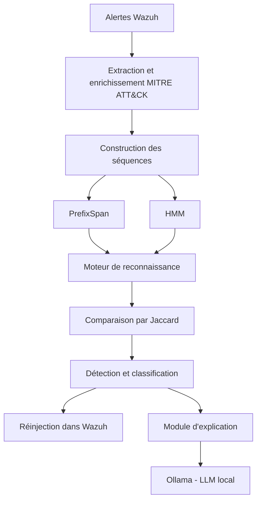

<p align="center"> 
  # MISE EN PLACE D'UN SYSTEME INTELLIGENT DE DETECTION AUTOMATIQUE DES CHAINES D'ATTAQUE DANS UN SIEM 
  </p>

<p align="center">
  <strong>Détecter les événements. Reconnaître les enchaînements. Comprendre les attaques.</strong>
</p>

<p align="center">
  
  
  
  
  
</p>

<p align="center">
  Projet de mémoire de fin d'études · (IAI)<br>
  Yaoundé, Cameroun · 2026
</p>

---

## Présentation

Une attaque informatique ne se résume pas toujours à une alerte isolée. Elle peut résulter d'un enchaînement d'actions qui, prises individuellement, semblent anodines, mais qui révèlent ensemble une progression malveillante.

Ce projet propose un système complémentaire à **Wazuh**, capable d'analyser les séquences de techniques d'attaque associées au référentiel **MITRE ATT&CK**, afin de reconnaître des schémas comportementaux récurrents et leurs variantes.

Il combine la fouille de motifs séquentiels, la modélisation probabiliste et la mesure de similarité. Les détections obtenues peuvent être réinjectées dans Wazuh et accompagnées d'explications en langage naturel générées localement avec Ollama.

**L'objectif : passer de l'analyse d'alertes individuelles à la reconnaissance de chaînes d'attaque.**

## Approche méthodologique

Le moteur de reconnaissance repose sur trois méthodes complémentaires :

| Méthode | Rôle |
|---|---|
| **PrefixSpan** | Extrait les motifs séquentiels récurrents dans les chaînes d'attaque. |
| **HMM** | Évalue la cohérence probabiliste des séquences avec les comportements appris. |
| **Similarité de Jaccard** | Compare les ensembles de techniques pour reconnaître des variantes, même lorsque leur ordre diffère. |

### Trois niveaux de détection

| Niveau | Type de correspondance | Méthode | Gravité Wazuh |
|:---:|---|---|:---:|
| 1 | Exacte et ordonnée | PrefixSpan | 12 |
| 2 | Probabiliste | HMM | 10 |
| 3 | Par ensemble, sans ordre | Jaccard | 8 |

Ces niveaux correspondent à la logique de classification configurée dans le prototype. Les gravités Wazuh ne représentent pas des probabilités statistiques de détection.

## Architecture



Wazuh conserve son rôle de SIEM : le système développé vient enrichir ses capacités d'analyse, sans le remplacer. Ollama intervient uniquement dans la génération des explications.

## Résultats expérimentaux

Les expérimentations ont permis d'obtenir les résultats suivants :

**Fouille de motifs séquentiels**

| Étape | Nombre de motifs |
|---|---:|
| Motifs extraits (support minimal : 3) | 1 265 |
| Après filtrage sur la longueur | 790 |
| Après suppression des sous-motifs redondants | 206 |

**Évaluation du HMM**

Le modèle a été entraîné sur 134 séquences d'attaque. Le seuil de décision utilisé est de -4,85.

| Indicateur | Résultat |
|---|---:|
| Précision | 1,00 |
| Rappel | 0,95 |
| F1-score | 0,97 |

**Précaution méthodologique :** les séquences d'attaque évaluées sont également celles utilisées pour entraîner le HMM. Le bruit testé est aléatoire et ne représente pas une activité légitime réelle. Ces résultats sont donc préliminaires et ne démontrent pas encore la généralisation du système à des attaques inconnues ou à un environnement de production.

## Données et technologies

Le corpus exploite des scénarios issus de jeux de données publics, notamment Mordor / Security-Datasets (OTRF), des chaînes d'attaque documentées et des scénarios construits manuellement. Les données propres à l'environnement Wazuh ne sont pas publiées lorsqu'elles contiennent des informations sensibles.

| Technologie | Utilisation |
|---|---|
| Python, Pandas | Développement et traitement des données |
| PrefixSpan | Fouille de motifs séquentiels |
| hmmlearn | Modélisation probabiliste |
| MITRE ATT&CK | Référentiel des techniques d'attaque |
| Wazuh | Supervision et gestion des alertes |
| Ollama – Llama 3.2 3B | Explication locale des détections |
| JSON / CSV | Stockage et échange des données |

## Installation

### Prérequis

- Linux
- Python 3.10 ou supérieur
- Git
- Wazuh pour l'intégration SIEM
- Ollama pour le module d'explication (facultatif)

### Récupération du projet

```bash
git clone https://github.com/love-line/model-detection-automatique-schemas-attaque-siem-wazuh.git

cd model-detection-automatique-schemas-attaque-siem-wazuh
```

### Préparation de l'environnement Python

```bash
python3 -m venv venv
source venv/bin/activate
pip install --upgrade pip
pip install -r requirements.txt
```

### Préparation du modèle local

Pour activer le module d'explication :

```bash
curl -fsSL https://ollama.com/install.sh | sh
ollama pull llama3.2:3b
```

## Utilisation

Le pipeline expérimental comprend les étapes suivantes :

```bash
python3 extractor.py
python3 train_patterns.py
python3 filter_patterns.py
python3 train_hmm.py
python3 calcul_seuil.py
python3 src/main.py
```

Les données nécessaires doivent être préparées avant l'exécution du moteur de détection. En particulier, les fichiers d'alertes et de séquences attendus par les scripts doivent être disponibles.

## Documentation complémentaire

Les guides suivants détaillent les configurations qui ne sont pas développées dans ce README.

| Documentation | Contenu |
|---|---|
| [`docs/integration-wazuh.md`](docs/integration-wazuh.md) | Connexion à Wazuh, décodeur personnalisé, règles et surveillance des détections |
| [`docs/ollama.md`](docs/ollama.md) | Installation d'Ollama, téléchargement du modèle, configuration et dépannage |

## Limites et perspectives

Le système reste un prototype expérimental. Les principales pistes d'amélioration sont :

- Évaluer le modèle sur des corpus indépendants et plus diversifiés.
- Tester la détection sur des activités légitimes réelles.
- Améliorer la généralisation à des scénarios d'attaque inconnus.
- Optimiser les seuils de décision du HMM et de Jaccard.
- Évaluer la qualité des explications générées auprès d'analystes.
- Étudier l'adaptation de l'approche à d'autres plateformes SIEM.

## Références

- [MITRE ATT&CK](https://attack.mitre.org/)
- [OTRF Security-Datasets – Mordor](https://github.com/OTRF/Security-Datasets)
- [Documentation Wazuh](https://documentation.wazuh.com/)
- [Ollama](https://ollama.com/)
- Pei, J. et al. (2001). *PrefixSpan: Mining Sequential Patterns Efficiently by Prefix-Projected Pattern Growth.* ICDE.
- Zhang, X. et al. (2022). *Multi-Step Attack Detection Based on Pre-Trained Hidden Markov Models.* Sensors, 22(8).

## À propos

**Loveline Yemeli**  
Ingénieure des travaux informatiques, option systèmes et réseaux.  
Institut Africain d'Informatique (IAI), Yaoundé.

Domaines d'intérêt : cybersécurité, administration systèmes et réseaux, détection d'intrusion et intelligence artificielle appliquée à la sécurité.

[LinkedIn](https://www.linkedin.com/in/yemeli-loveline) · [GitHub](https://github.com/love-line)

## Licence

Ce projet est distribué sous licence MIT. Voir le fichier [`LICENSE`](LICENSE).
